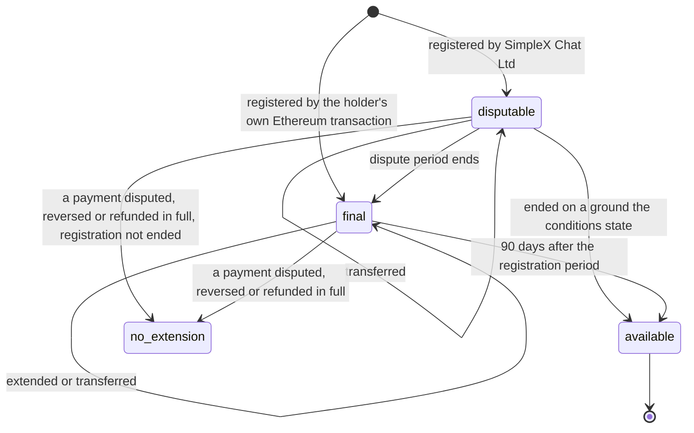

# Names Conditions: dispute period

Repository: simplex-chat/simplex-chat.
Branch: `ab/names-dispute-period`.
Base: master `44a193b54` (#8266).

The user's words:

> registration can define a "dispute period" during which the guardian role can unregister a name

> renewals are final

> also submit a PR to change the name terms accordingly

## Problem

A holder accepts docs/NAMES-CONDITIONS.md on chain. It states that changing a name's record and subnames requires the holder's key, and that a name can be extended until 90 days after its period ends.

The registry contracts change on simplex-network/ens-contracts, branch `ab/dispute-period`:

- a registration through the store's registrar has a dispute period of 14 to 120 days, stored in the registry;
- before it ends, the registry's guardian or admin can end the registration, with its record and subnames;
- before it ends, the name cannot be extended;
- a registration by the holder's own Ethereum transaction is not subject to a dispute period.

The conditions would describe a registry that holders do not get.

## Registration states

## Changes

docs/NAMES-CONDITIONS.md, section "What the registry allows":

| Bullet | Change |
|---|---|
| your key | the next point as its exception |
| dispute period | new, second |
| period and extension | after the dispute period, if any |
| refused extensions | new, last |

The dispute period bullet states:

- which registrations have one, and its length;
- what the registry allows before its end;
- the only grounds for ending a registration;
- the name's availability after;
- that a transfer leaves it unchanged.

The other sections are unchanged. A separate change, for the registry's upgradeable contracts, edits the section "Registry"; the change merged second merges master.

## After the merge

The name policy's general and community terms links are set to this file at the merge commit of the later of this change and the change for the upgradeable contracts:

1. tagged `general-terms-vN` and `community-terms-vN`;
2. mirrored on git.simplex.chat;
3. set in the same governance batch as `setSponsor` of the sponsor that takes `disputeDays`, so that every registration with a dispute period is made under this version.
