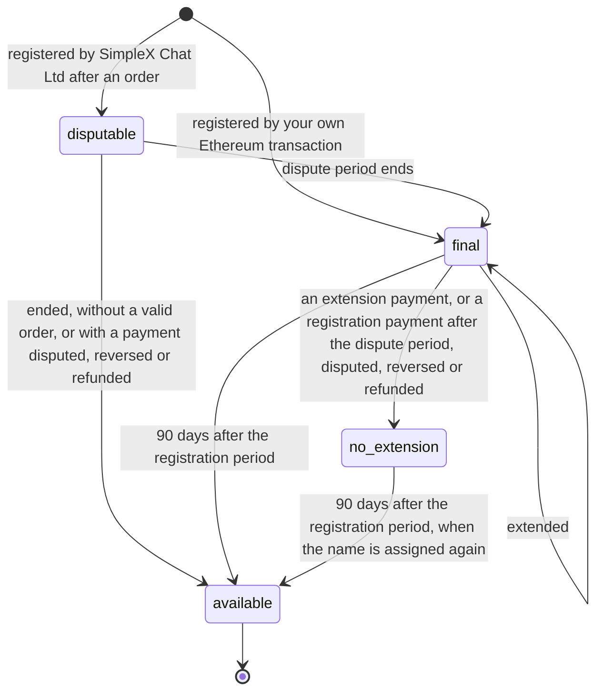

# Names Conditions: dispute period

Repository: simplex-chat/simplex-chat.
Branch: `ab/names-dispute-period`.
Base: master `44a193b54` (#8266).

The user's words:

> registration can define a "dispute period" during which the guardian role can unregister a name

> renewals are final

> also submit a PR to change the name terms accordingly

## Problem

A holder accepts docs/NAMES-CONDITIONS.md on chain. It states that changing a name's record and subnames requires the holder's key, and that a name can be extended until 90 days after its period ends.

The registry contracts change on simplex-network/ens-contracts, branch `ab/dispute-period`:

- a name that SimpleX Chat Ltd registers for an order has a dispute period of 14 to 120 days, stored in the registry;
- before it ends, the registry's guardian or admin can end the registration, with its record and subnames;
- before it ends, the name cannot be extended;
- a name registered by the holder's own Ethereum transaction has none.

The conditions would describe a registry that holders do not get.

## Registration states

## Changes

docs/NAMES-CONDITIONS.md, section "What the registry allows":

| Bullet | Change |
|---|---|
| your key | ending a registration in its dispute period removes its record and subnames without the key |
| period and extension | extension only once any dispute period has ended; "the period" named "the registration period" |
| dispute period, new | who has one, its length, the grounds for ending, availability after, transfers |
| refused extensions, new | after a disputed extension payment, or a registration payment disputed after its dispute period |

The other sections are unchanged.

## After the merge

The name policy's general and community terms links are set to this file at the merge commit, as for #8135.
